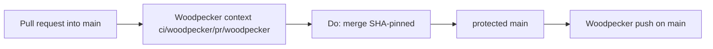

# Architecture overview

`code/wordpress-blog-ai-poster` is a Python CLI in org **code**. It is not
the identity-smoke canary (`code/hello`). Standing merge and CI rules live
here. Catch-all `CODEOWNERS` removal is decided in
[ADR 0001](adr/0001-remove-catchall-codeowners.md)
([#3](https://git.cl8y.com/code/wordpress-blog-ai-poster/issues/3)); do not
duplicate that narrative.

This tree does not change Forgejo protection JSON, CAC autoland predicates,
or WordPress/OpenAI/Tavily spend. Those remain
[cl8y-forgejo#48](https://git.cl8y.com/PlasticDigits/cl8y-forgejo/issues/48),
[cl8y-agent-control#429](https://git.cl8y.com/PlasticDigits/cl8y-agent-control/issues/429),
and
[agent-control #297](https://git.cl8y.com/PlasticDigits/cl8y-agent-control/issues/297).

## Land vehicle

Occupying PR
[#3](https://git.cl8y.com/code/wordpress-blog-ai-poster/pulls/3) is
**closed** (`merged: true` at 2026-09-21T13:10:31Z, merge `2a81aac`, head
`4a77cb8`, `changed_files: 1`, `+0/−6`). Occupancy on that number is done.
**S1** (four-path absence) is already on `origin/main`. Remaining work is
**S0+S2 only** (ADR 0001 + this overview + README pointer) on a **new
branch from current `origin/main`**, shipped as a **new iid and new PR**.
Do not reopen `#3`. Do not update `#3` only. Merging the successor does
**not** close `#3`. Design branch `cac-design-issue-3` is
review/transport only; do not merge it (it still carries root
`CODEOWNERS`). Copy docs with a **path-limited** checkout (ADR 0001
combine step). Do not whole-tree copy that transport SHA.

## Product tree

CLI entry is [`wp_ai_poster.py`](../wp_ai_poster.py). It generates a draft
from OpenAI (optional Tavily topic via [`blog_topic.py`](../blog_topic.py)),
applies [`Context_*.md`](../Context_Goal.md) style/knowledge/topic/goal
files, optionally writes SEO fields ([`wp_add_meta.py`](../wp_add_meta.py)),
and posts via WordPress XML-RPC or saves HTML. Secrets live in `.env`
(gitignored). This overview does not redesign generation, SEO, or publish.

Woodpecker ([`.woodpecker.yml`](../.woodpecker.yml), landed by
[#1](https://git.cl8y.com/code/wordpress-blog-ai-poster/pulls/1)) runs
`python -m compileall -q .` on `push`, `manual`, and `pull_request`. The
successor PR does not add scanners, secrets, or a deploy step.

`.gitignore` is `.env` and `__pycache__` only. `docs/` is **not** ignored.
Do not copy Foundry `docs/*` exceptions from `code/BASE_Buster`.

## Merge gate (H3)

Protected `main` (GET `updated_at` 2026-09-21T07:29:31Z, after
[cl8y-forgejo#48](https://git.cl8y.com/PlasticDigits/cl8y-forgejo/issues/48)
rollout on this repo). Flag *values* match the canary table in `code/hello`
architecture **H15**; IDs here are **H3-*** because this ticket is
[#3](https://git.cl8y.com/code/wordpress-blog-ai-poster/issues/3).

Unauthenticated protection GET is **401**. Matching below is operator
attestation, not something Woodpecker `compileall` can prove. Independent
review of a design SHA cannot re-GET protection. The successor PR must not
PATCH protection.

### GET-required (leftover-complete item 1 and test 3 — same list)

These are the only protection fields leftover-complete depends on. They are
**not** a land close criterion for the successor PR. Pin one path:
`GET /api/v1/repos/code/wordpress-blog-ai-poster/branch_protections`
(array; pick the object with `rule_name == "main"`). Confirm each:

| ID | Field | Required value |
| --- | --- | --- |
| **H3-2** | `enable_push` | `false` (no direct `main`, no force-push) |
| **H3-3** | `enable_status_check` + `status_check_contexts` | `true` and **equal** `["ci/woodpecker/pr/woodpecker"]` (not a subset; do not add a required push context on PR tips) |
| **H3-5** | `block_on_rejected_reviews` | `true` |
| **H3-8** | `block_on_official_review_requests` | `false` (leftover official requests on closed [#3](https://git.cl8y.com/code/wordpress-blog-ai-poster/pulls/3) / open [#2](https://git.cl8y.com/code/wordpress-blog-ai-poster/pulls/2) must not block) |
| **H3-9** | `required_approvals` | `0` |

Do not include **H3-4** (`Do: merge`) in GET matching: it is the merge API,
not a protection field. **H3-8** is what decides whether an official
CODEOWNERS request blocks merge, not `enable_status_check`.

### GET-observed (do not touch; not in leftover matching)

| Field | Observed value | Rule |
| --- | --- | --- |
| `block_on_outdated_branch` | `true` | Do not PATCH from the successor PR. Product head must rebase onto current `main` before merge. |
| `dismiss_stale_approvals` | `true` | Do not PATCH from the successor PR. |
| `apply_to_admins` | `false` | Do not PATCH from the successor PR. |

Leftover-complete item 1 / test 3 must **not** be read as “GET equals this
whole architecture table.” Observed rows are inventory so an implementer
does not “fix” them.

### Non-GET rules

| ID | Rule |
| --- | --- |
| **H3-1** | None of the four Forgejo search paths exist on `main` (`test ! -e CODEOWNERS`, `test ! -e docs/CODEOWNERS`, `test ! -e .gitea/CODEOWNERS`, `test ! -e .forgejo/CODEOWNERS`). Same sentence as test 1 and land close (tree). File line `@code/maintainers` / JSON team `maintainers` is the leftover plant this absence stops. Already true on `origin/main` after S1. |
| **H3-4** | Merge is SHA-pinned `Do: merge` (`head_commit_id`). Never document or use `force_merge`. |
| **H3-6** | No Coolify/Woodpecker secrets on `pull_request`. This tree does not grow a deploy step from the successor PR. WordPress publish and OpenAI/Tavily spend stay [#297](https://git.cl8y.com/PlasticDigits/cl8y-agent-control/issues/297). |
| **H3-7** | This tree does not expand CAC merge/deploy/spend/custody policy. |

Official CODEOWNERS review is **not** a merge gate. A catch-all file still
plants team `maintainers` (`@code/maintainers`) requests on every non-WIP
PR. Runtime search (first existing blob wins) is root / `docs/` / `.gitea/`
/ `.forgejo/` (Go-regexp, not GitHub globs; `.forgejo/` added in
forgejo#8773; `.gitea/` remains in the walk). After ADR 0001, **H3-1**
holds on `main` (S1 merged). Do not leave an empty or comments-only file;
Forgejo still parses it. The successor must not restore any of the four
paths.

README must point at this gate and ADR 0001. Architecture-only is not a
substitute for that pointer. See ADR 0001 decision 3 / slice S2. The
heading slug for this section is `#merge-gate-h3`, not `#H3`.

Do not add a local `docs/INVARIANTS.md`. The issue body points at
cl8y-forgejo’s copy (private to this tree). Local merge-gate rules are
**H3-*** here and in ADR 0001.

## Pipeline

[`.woodpecker.yml`](../.woodpecker.yml) is the compileall stub from #1:
`python:3.12-bookworm` / `python -m compileall -q .`. It posts the required
merge context `ci/woodpecker/pr/woodpecker`. It is not the hello scanner
suite. The successor PR does not upgrade, digest-pin, or add secrets to
that file. Keep the existing `python` step.

This repo has no Coolify app and no Woodpecker deploy step. Do not attach
secrets to `pull_request` events. WordPress XML-RPC publish is operator
runtime under
[#297](https://git.cl8y.com/PlasticDigits/cl8y-agent-control/issues/297),
not merge policy.
